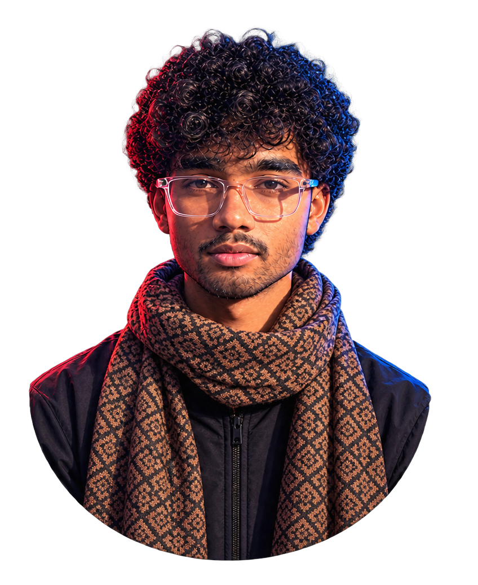

<!-- =========================================================
     SOMEN BAURI | CYBERPUNK GITHUB PROFILE
     Replace/add assets only where indicated.
     ========================================================= -->

 

---

<!-- 01 / ABOUT ME -->

<table>
<tr>
<td width="62%" valign="top">

### `> whoami`

Hey! I'm **Somen Bauri** — a student exploring the world of technology, software development, and creative engineering.

I'm interested in understanding how things work and turning what I learn into practical projects.

- `01` — Exploring web development and building digital experiences.
- `02` — Learning how AI can support real-world workflows.
- `03` — Exploring robotics, automation, and engineering concepts.
- `04` — Improving through experimentation, practice, and projects.

**Current mode:** `LEARN → BUILD → TEST → IMPROVE`

</td>
<td width="38%" align="center" valign="middle">

</td>
</tr>
</table>

`[ CURIOSITY ]` ━━━━━ ` [ EXPERIMENTATION ]` ━━━━━ `[ PROGRESS ]`

---

<!-- 02 / TECH STACK -->

 

  

**WEB TECHNOLOGIES**

  

**DEVELOPMENT TOOLS**

  

---

<!-- 03 / AREAS OF INTEREST -->

  

*Four directions. One curious mind. Always exploring.*

<table>
<tr>
<td width="50%" valign="top" align="center">

  

**Digital Experiences**

Exploring website design, front-end development, layouts, and interactive interfaces.

</td>
<td width="50%" valign="top" align="center">

  

**Smarter Workflows**

Interested in AI-assisted development, practical automation, and solving useful problems with technology.

</td>
</tr>
<tr>
<td width="50%" valign="top" align="center">

  

**Engineering & Robotics**

Previous exposure to FTC robotics, Java programming, robot mechanisms, and engineering concepts.

</td>
<td width="50%" valign="top" align="center">

  

**Technology Meets Creativity**

Interested in interactive experiences that combine technology, imagination, and practical problem-solving.

</td>
</tr>
</table>

---

<!-- 04 / MY JOURNEY -->

  

<table>
<tr>
<td width="18%" align="center" valign="top">

</td>
<td width="82%" valign="top">

### `01` — Robotics & Creative Technology

- FTC Pune — Team Astrobot `#22988`.
- Snapchat AR hackathon experience.

</td>
</tr>
<tr>
<td align="center" valign="top">

</td>
<td valign="top">

### `02` — Engineering Experiments

- FTC Goa and technology exhibitions.
- Home-appliance automation project experience.
- Sensor-stick concept intended to assist people who are blind.

</td>
</tr>
<tr>
<td align="center" valign="top">

</td>
<td valign="top">

### `03` — Continued Exploration

- Snapchat AR hackathon experience.
- Continued interest in creative technology.

</td>
</tr>
<tr>
<td align="center" valign="top">

</td>
<td valign="top">

### `04` — Web Development & AI

- Focusing on web development and AI-assisted coding.
- Exploring practical projects and automation concepts.

</td>
</tr>
</table>

---

<!-- 05 / PROJECT SHOWCASE -->

  

<table>
<tr>
<td width="50%" valign="top">

### `PROJECT_01`

  

**FTC Robotics Experience**

Exposure to team-based robotics through FTC events with Team Astrobot `#22988`.

 

</td>
<td width="50%" valign="top">

### `PROJECT_02`

  

**Home-Appliance Automation**

An engineering experiment exploring automation of home appliances.

 

</td>
</tr>
<tr>
<td width="50%" valign="top">

### `PROJECT_03`

  

**Sensor Stick Concept**

An assistive-technology concept intended to help a blind person navigate with sensor-based assistance.

 

</td>
<td width="50%" valign="top">

### `PROJECT_04`

  

**Web Development Experiments**

Exploring layouts, interfaces, and modern web technologies while developing practical skills.

 

</td>
</tr>
</table>

Project descriptions reflect known experience and interests. Public demo links can be added when available.

---

<!-- 06 / GITHUB ANALYTICS -->

  

  

  

---

<!-- 07 / MINDSET -->

 

---

<!-- 08 / CONNECT -->

 

Open to connecting with people who enjoy technology, web development, robotics, and learning.

  

  

Designed with curiosity and a little cyberpunk energy.

